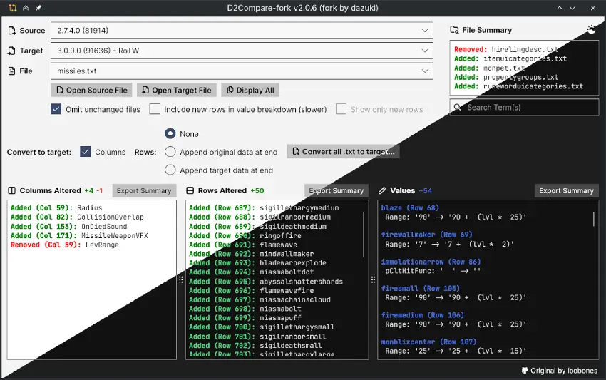

This is a fork of [locbones/D2Compare](https://github.com/locbones/D2Compare).

The original WinForms application has been migrated to [Avalonia UI](https://avaloniaui.net/) for cross-platform support (Windows and Linux) and changed target framework from .NET 7 to .NET 10 (LTS).

### New in D2Compare-fork
- Remember Source/Target/Custom dropdown selections between sessions
- Window size, position, and panel proportions saved automatically
- Display All (Batch Mode) with "Omit unchanged files" filter
- "Show only new rows" filter for value breakdown
- Diff stats per panel (+added -removed ~changed)
- Export Summary per panel. Save results as a text file for use outside D2Compare
 
## Requirements

### Windows

.NET 10 SDK or Runtime (LTS)

Download: https://dotnet.microsoft.com/en-us/download/dotnet/10.0

### Linux

**AppImage (no .NET install needed):** download `D2Compare-<version>-x86_64.AppImage` from the [releases](https://github.com/dazuki/D2Compare-fork/releases), then:
```bash
chmod +x D2Compare-*-x86_64.AppImage
./D2Compare-*-x86_64.AppImage
```

**Or the `.tar.gz` build with the .NET 10 runtime:**

**Ubuntu/Debian:**
```bash
sudo apt install dotnet-runtime-10.0
```

**Fedora:**
```bash
sudo dnf install dotnet-runtime-10.0
```

**Arch Linux:**
```bash
sudo pacman -S dotnet-runtime-10.0
```